<p align="left">
  
  
  &nbsp;&nbsp;&nbsp;
  
  
</p>

<p align="center">
  
  
  <br>
  &thinsp;&thinsp;
</p>

<p align="center">
  <a href="README.md">简体中文</a> · <a href="README_EN.md">English</a> · <strong>日本語</strong>
</p>

<p align="center">
  あなた専用の、進化し続けるソーシャルメディアのコンテンツアシスタントです。<br>
  アイデアから始めて、発見、計画、制作、公開、そして学習まで行います。
</p>

<p align="center">
  <a href="https://zju-real.github.io/Easel/"></a>
  
  
  <a href="docs/skill-function-mapping.md"></a>
  <a href="https://github.com/ZJU-REAL/Easel/stargazers"></a>
  <a href="https://github.com/ZJU-REAL/Easel/releases/latest"></a>
  <a href="LICENSE"></a>
  <a href="assets/readme/wechat-group.png"></a>
</p>

<p align="center">
  <a href="https://trendshift.io/repositories/195527?utm_source=trendshift-badge&utm_medium=badge&utm_campaign=badge-trendshift-195527" target="_blank" rel="noopener noreferrer"></a> <a href="https://trendshift.io/repositories/195527?utm_source=trendshift-badge&utm_medium=badge&utm_campaign=badge-trendshift-195527" target="_blank" rel="noopener noreferrer"></a>
</p>


## 🎨 Easel とは？

Easel は、ソーシャルメディアのクリエイターのためのオープンソースのコンテンツワークスペースです。OpenClaw Agent、アカウントのプロフィール、コンテンツの Skill、実際のメディアツールをつなぎ、Agent が何をすべきかを説明するだけでなく、実際にコンテンツを制作してアーカイブできるようにします。必要に応じて、直接またはオンデマンドで公開することもできます。

Easel は、あなたのポジショニング、オーディエンス、語り口、プラットフォームの制約、好み、過去の成果を覚えているコンテンツのパートナーだと考えてください。トレンドの発見から公開まで寄り添い、そこで学んだことを次の制作サイクルに引き継ぎます。

### ローカルの OpenAI 互換ゲートウェイ

`.env` で独立したゲートウェイを設定します：

```dotenv
EASEL_DIRECT_API_BASE_URL=http://localhost:50288/v1
EASEL_DIRECT_API_MODEL=your-model-id
EASEL_DIRECT_API_KEY=your-real-gateway-key
```

完全な `/chat/completions` の URL ではなく、`/v1` を含むベース URL を使ってください。認証のないゲートウェイの場合は、キーを空のままにしてください。

- `bash setup.sh` はデフォルトで OpenClaw を使います。完全な独立した設定を行うと、OpenClaw のツールランタイムを備えた `local-api` プロバイダーが作成され、設定したプライベートゲートウェイへのリクエストが許可されます。モデルはツール呼び出しに対応している必要があります。インストールの前に `.env` を設定してください。ターミナルでのモデル選択ウィザードはありません。
- `bash setup.sh --api` は、OpenClaw のインストール、スキルの同期、Gateway の起動をスキップします。あるいは、Web のモデル設定で **API direct** を選ぶか、手動で `EASEL_CHAT_TRANSPORT=api` を設定してください。
- ダイレクトモードは、ストリーミングチャット、個別のマルチターン履歴、プロフィール、テキスト/画像の添付、停止、再接続に対応しています。ローカルのツール、スキル、公開は実行できません。モードを変更したら、新しい会話を始めてください。
- ダイレクトの設定は `EASEL_DIRECT_API_*` だけを読み込み、`OPENAI_*` にフォールバックすることはありません。CLI の `chat`、`ping`、`doctor` はダイレクトモードを認識します。`ping` は実際の接続を検証します。設定済みのバッジが表示されているだけでは、接続は確認されていません。

これらのインストーラーのオプションは、Linux/macOS の `setup.sh` に適用されます。Windows のユーザーは、`.env` または Web の設定でダイレクトモードを設定できます。

Easel のプロモーションデモ：

https://github.com/user-attachments/assets/4dd060dc-53dd-4bb2-99a3-e65ab6f65166

Easel は、つながった 5 つのワークフローに沿って動きます：関連するトレンドと機会を **発見（Discover）** し、トピック、フック、台本、スケジュールを **計画（Plan）** し、テキスト、音声、動画を **制作（Produce）** し、チェック済みでプラットフォームに対応したコンテンツを適切なプラットフォームに直接 **公開（Publish）** し、成果のインサイトをアカウントのプロフィールに **還元（Attribute）** します。

#### 📌 利用上の注意と研究のビジョン

> - **完全な体験には Web ワークスペースを使ってください：** CLI のエントリーポイントにはない、会話、アセット、アカウント、プロフィール、コンテンツライブラリ、公開の管理が含まれており、Easel の推奨の使い方です。ターミナルのみで起きる表示の不具合については、[既知の問題](docs/known-issues_EN.md)をご覧ください。
> - **小紅書（Xiaohongshu）での自動公開には注意してください：** 自動化によって、認証の要求、リーチの制限、アカウントのリスクが生じることがあります。プレビューと公開前のチェックを使い、人が確認してから公開する方法をおすすめします。
> - **研究を実生活に応用：** Easel は、私たちの研究を実際のソーシャルメディアのワークフローに持ち込みます。クリエイター、オーディエンス、本物のやり取りへのより深い理解を含め、ソーシャルメディアにおける AI のソーシャルインテリジェンスの探求を続けていきます。

## ✨ なぜ Easel なのか？

- **ワークフロー全体をひとつの Agent で：** トレンドの発見、トピックの評価、カレンダーの計画、コピーとビジュアルの生成、動画の制作、公開、結果の分析を、ひと続きの流れで行えます。
- **プロフィール主導の制作：** 各アカウントには、独自のポジショニング、スタイル、オーディエンス、プラットフォーム、好み、境界線、長期的な記憶があります。
- **実行可能な Skill：** 画像、カード、ナレーション、字幕、編集、ショートドラマ、公開の Skill には実行可能なツールが含まれ、成果物を `outputs/` に保存します。
- **ひとつの素材から複数のプラットフォームへ：** プラットフォームの慣習を守りながら、ひとつのアイデアを小紅書のカード、ショート動画、知乎（Zhihu）の記事、短い投稿に展開します。
- **プロジェクト単位の成果物：** 元の素材、中間ファイル、メタデータ、最終的な成果物がまとめて保存されるので、修正、再試行、公開がしやすくなります。
- **公開と学習のループ：** Easel は、小紅書、抖音（Douyin）、快手（Kuaishou）、知乎、Bilibili、WeChat Channels、WeChat 公式アカウント、今日頭条（Toutiao）向けのログイン、プラットフォームへの適応、公開のワークフローに対応しており、成果のデータはアカウントのプロフィールにフィードバックされます。

## 🧭 5 層のコンテンツワークフロー

1. **発見：** トレンドのトピック、業界ニュース、競合、ユーザーの会話を集約し、関連する機会を見つけます。
2. **計画：** 機会を、トピック、タイトル、台本、コンテンツシリーズ、カレンダーの項目に落とし込みます。
3. **制作：** コピー、カード、ポスター、インフォグラフィック、音声、動画、ショートドラマ、論文の解説を作成します。
4. **公開：** タイトル、コピー、アスペクト比、メディアを各プラットフォームに合わせて調整し、公開前のチェックを行い、ログイン済みのアカウントで公開します。
5. **還元：** 閲覧数、エンゲージメント、コメント、コンテンツの成果を集め、役に立つパターンをアカウントのプロフィールに保存します。

## 🧰 実装済みの機能

トレンドレーダーは、バージョン管理されたデータ契約を通じて、ユーザー定義の Python コレクター、HTTP サービス、RSS/Atom フィードを受け付けます。既存の 6 つのプラットフォームも同じパイプラインを使っており、独自のソースを追加してもフロントエンドを変更する必要はありません。

| レイヤー | 機能 |
|---|---|
| **発見** | クロスプラットフォームのトレンド、特定分野のリサーチ、コンテンツのギャップ分析、イベントカレンダー、アルゴリズムの更新、競合リサーチ、業界ニュース、プラットフォームの違い、RSS の集約、UGC の発見 |
| **計画** | ポジショニング、オーディエンスのプロフィール、ペルソナと語り口、アカウントの診断、コンテンツマトリクス、トピックのスコアリング、トレンドへの適応、シリーズの計画、フック、アウトライン、絵コンテ、カレンダー、リパーパス、ライブ配信、キャンペーン、コラボレーション |
| **テキストとビジュアル** | ソーシャル向けのコピー、動画の台本、小紅書のノート、長文の記事、小説、自然なリライト、スタイルの変換、論文の解説、引用カード、知識カード、ポスター、インフォグラフィック、グラフ、マインドマップ、比較カード、商品画像、ミーム、AI 画像、画質の向上、背景の除去、バッチ処理 |
| **音声と動画** | テキスト読み上げ、複数の役の吹き替え、音声のクローン、AI 音楽、ノイズ除去、ミキシング、文字起こし、音声のビジュアライズ、AI 動画、ショートドラマ、字幕、翻訳、編集、クリップの切り出し、ハイライト、形式の変換、イントロ/アウトロ、スライドショー、ビートの同期、グリーンバック、動画から記事への変換 |
| **公開と還元** | 品質ゲート、リスクチェック、検索最適化、公開のチェックリスト、プラットフォームへの適応、7 つのプラットフォームの公開ワークフロー、カレンダーの記録、アカウントの分析、コメントのインサイト、振り返り、ROI、プロフィールの記憶 |

## 🖥️ ワークスペースの例

以下は 4 つの代表的な例であり、機能のすべてではありません。詳しくは、Web ワークスペースの Skill ライブラリや[機能マップ](docs/skill-function-mapping.md)をご覧ください。

<table>
  <tr>
    <td width="50%" valign="top"><strong>🧬 アカウントのプロフィール</strong><br><sub>アイデンティティ、ソーシャルリンク、目標、好み、境界線から、再利用できるアカウントのコンテキストを構築します。</sub><br><br>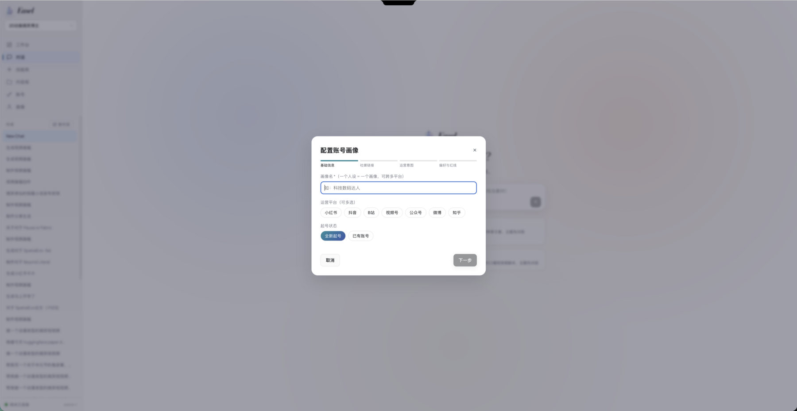</td>
    <td width="50%" valign="top"><strong>🔥 トレンドレーダー</strong><br><sub>主要なプラットフォームのリアルタイムのトレンドを集約し、現在のアカウントに関連するトピックを見つけます。</sub><br><br>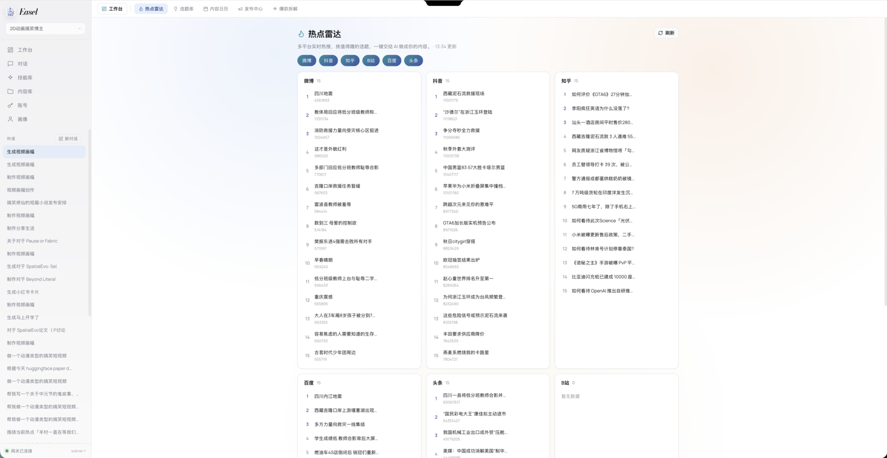</td>
  </tr>
  <tr>
    <td width="50%" valign="top"><strong>📅 コンテンツカレンダー</strong><br><sub>アイデア、下書き、予約投稿、公開済みの作品、プラットフォームのイベント、日々の計画を管理します。</sub><br><br>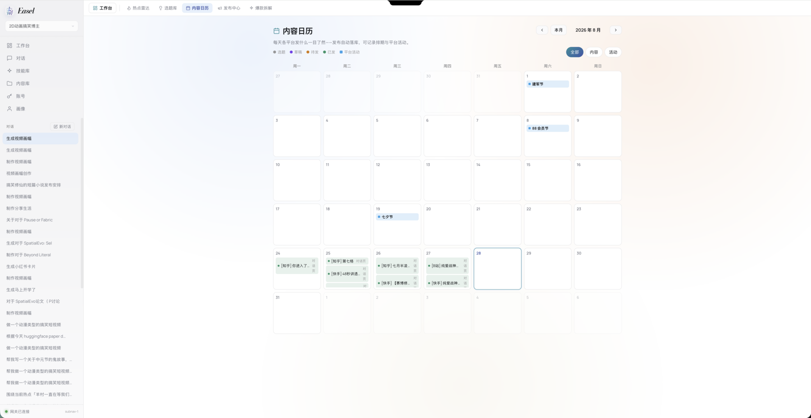</td>
    <td width="50%" valign="top"><strong>📣 パブリッシングセンター</strong><br><sub>ひとつのマスターアセットからプラットフォームごとのバージョンを生成し、プレビューしてチェックを行い、公開します。</sub><br><br>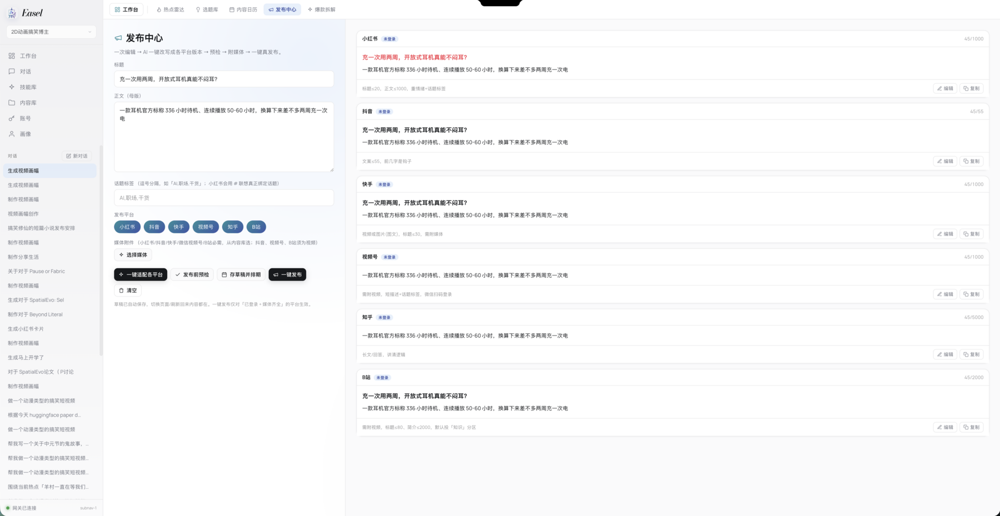</td>
  </tr>
</table>

## 🖼️ 実際の成果物

以下の例は、実際の Easel のワークフローで制作されたものです。README のメディアは `assets/readme/` に保存されており、プロジェクトページでは `web/static/showcase/` にある 6 秒間の軽量なプレビューを使っています。

### 📚 論文の解説と知識カード

<p align="center">
  
  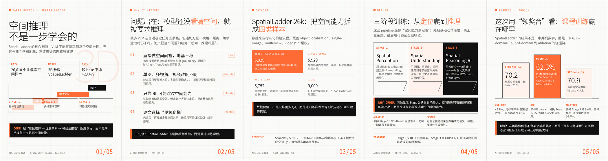
</p>
<p align="center">
  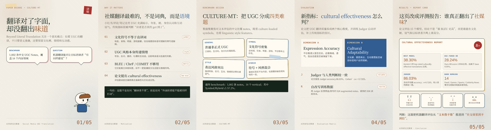
  
</p>

### 📖 小説と物語

<p align="center">
  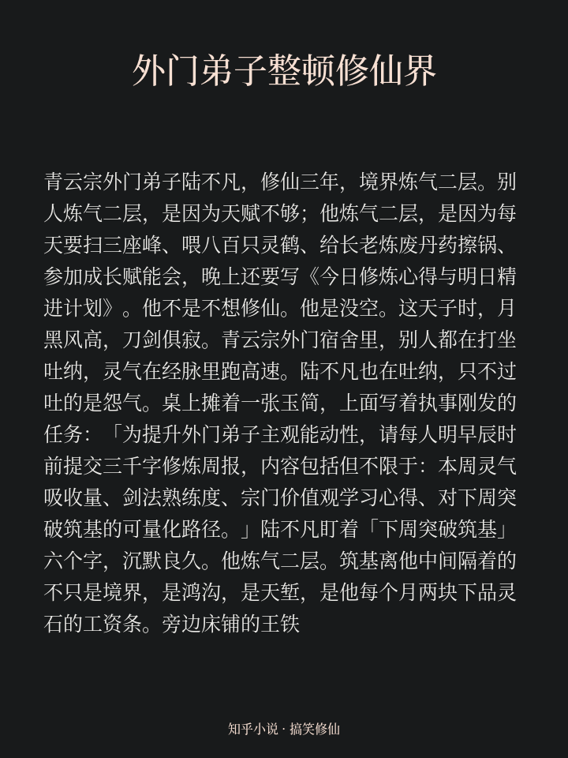
  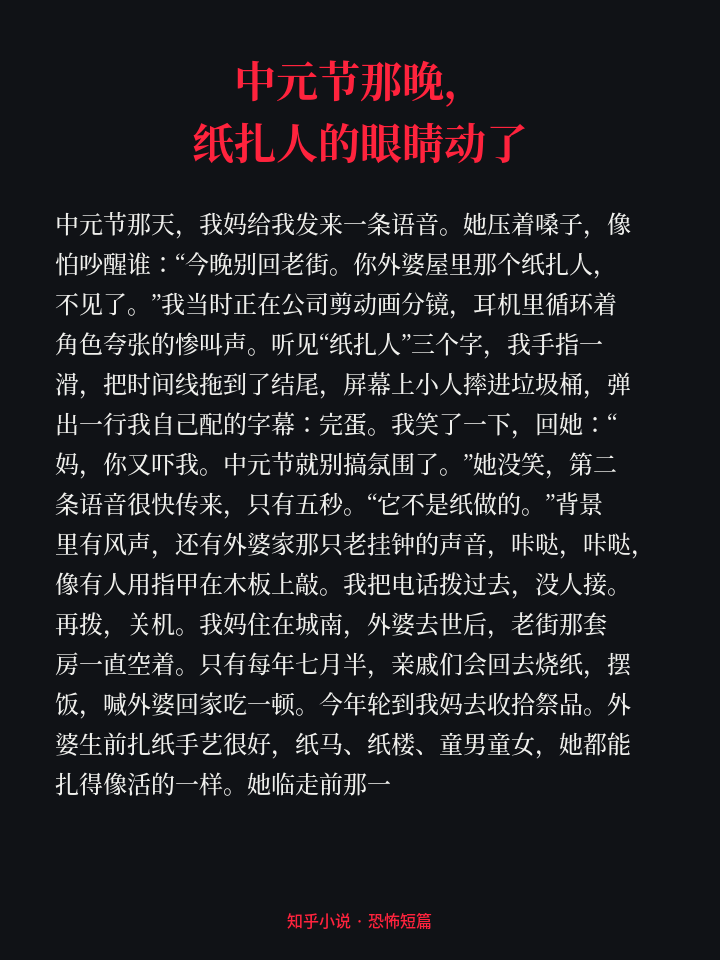
  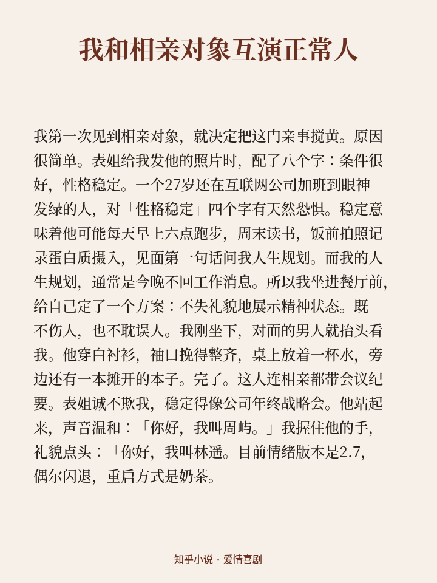
  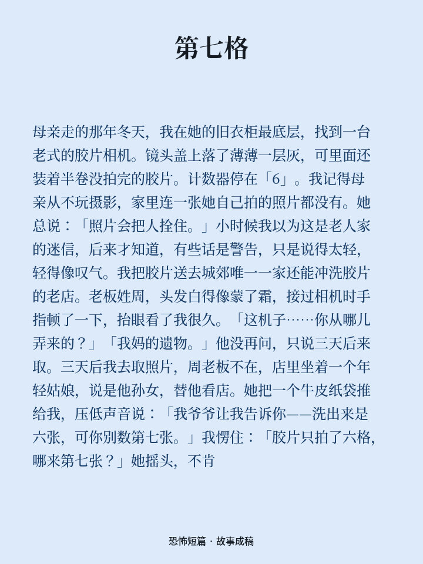
</p>

### 🌿 ライフスタイルとミームのコンテンツ

<p align="center">
  
  
</p>
<p align="center">
  
  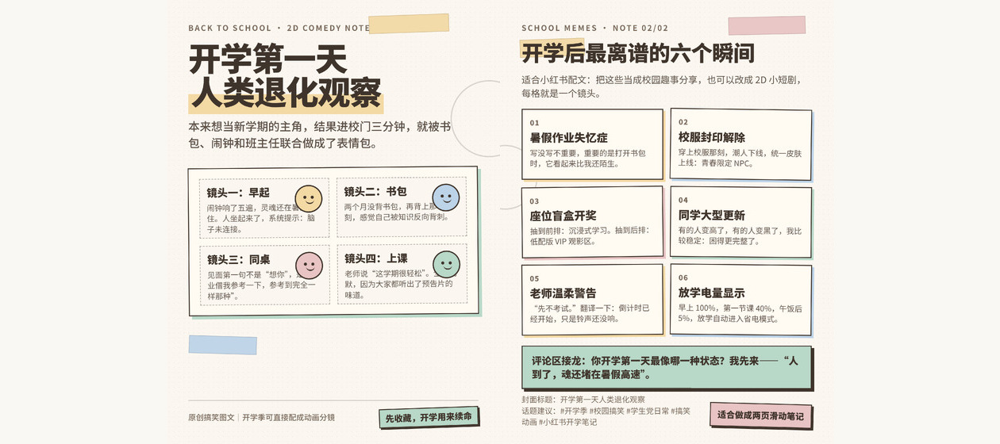
</p>

### 🎬 完成した動画

すばやく閲覧できるよう、各カバーからは最大 1 分の軽量なプレビューが開きます。完全な動画は、各行の下にあるリンクからご覧ください。

<p align="center">
  <a href="assets/readme/videos/preview/spatialladder-explainer.mp4">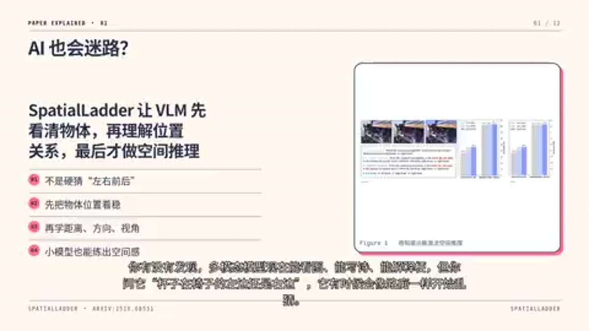</a>
  <a href="assets/readme/videos/preview/culture-mt-explainer.mp4"></a>
</p>
<p align="center"><sub>完全な動画：<a href="assets/readme/videos/full/spatialladder-explainer.mp4">SpatialLadder</a> · <a href="assets/readme/videos/full/culture-mt-explainer.mp4">CULTURE-MT</a></sub></p>

<p align="center">
  <a href="assets/readme/videos/preview/ordinary-person.mp4"></a>
  <a href="assets/readme/videos/preview/hanako-change.mp4"></a>
  <a href="assets/readme/videos/preview/cyber-cultivation.mp4"></a>
  <a href="assets/readme/videos/preview/cyber-turtle.mp4"></a>
</p>
<p align="center"><sub>完全な動画：<a href="assets/readme/videos/full/ordinary-person.mp4">Ordinary Person</a> · <a href="assets/readme/videos/full/hanako-change.mp4">Hanako's Change</a> · <a href="assets/readme/videos/full/cyber-cultivation.mp4">サイバー修仙</a> · <a href="assets/readme/videos/full/cyber-turtle.mp4">サイバーカメの大食い配信</a></sub></p>

<p align="center">
  <a href="assets/readme/videos/preview/jilong-news.mp4">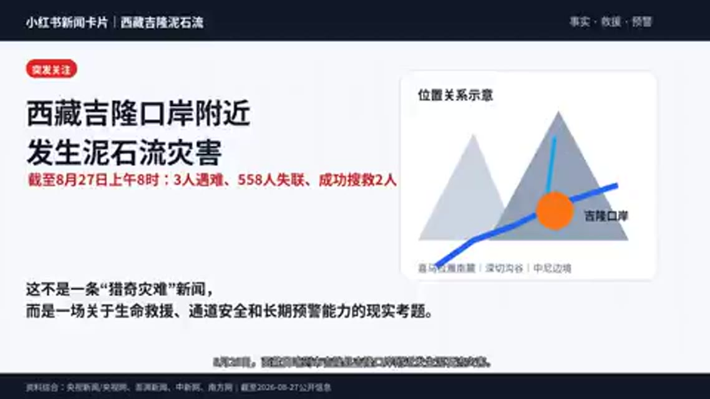</a>
  <a href="assets/readme/videos/preview/daomu-book.mp4"></a>
  <a href="assets/readme/videos/preview/zju-intro.mp4"></a>
</p>
<p align="center"><sub>完全な動画：<a href="assets/readme/videos/full/jilong-news.mp4">吉隆の地滑りのニュース</a> · <a href="assets/readme/videos/full/daomu-book.mp4">盗墓筆記の紹介</a> · <a href="assets/readme/videos/full/zju-intro.mp4">浙江大学</a></sub></p>

## 🚀 クイックスタート

必要なもの：Linux、macOS、または Windows 10/11、Python 3.10+、Git。インストーラーは、Node.js 24.16+（24.x）、26.1+（26.x）、または 27+（25.x と 26.0 は非対応）と、FFmpeg、Playwright/Chromium を確認します。Node.js がない場合は、プラットフォームごとの手順を案内します。

```bash
git clone git@github.com:ZJU-REAL/Easel.git
cd Easel
bash setup.sh
source .venv/bin/activate    # easel is installed in .venv; activate it first (Windows: .venv\Scripts\activate)
easel web
# Or: easel chat
```

> `easel: command not found` と表示される場合は、仮想環境が有効になっていません。有効にせずにフルパスで実行することもできます。例：`.venv/bin/easel doctor`（Windows：`.venv\Scripts\easel.exe doctor`）。

ネイティブの Windows 10/11 では、PowerShell で次を実行してください。WSL や Bash は不要です：

```powershell
git clone https://github.com/ZJU-REAL/Easel.git
cd Easel
Set-ExecutionPolicy -Scope Process Bypass
.\setup.ps1
.\.venv\Scripts\easel.exe doctor
.\.venv\Scripts\easel.exe web
```

Windows のインストーラーは、利用可能な場合は `winget` を使って不足しているシステムツールをインストールし、`.venv` を作成し、Python とフロントエンドの依存関係をインストールし、Web UI をビルドし、Playwright Chromium をインストールします。Easel は独立した `easel` の OpenClaw プロフィールを使います。Windows PowerShell 5.1 に対応しています。ネイティブのインストールと Web/CLI のエントリーポイントは利用可能ですが、個々のスキルやブラウザでの公開における Windows との幅広い互換性は、引き続き改善中です。

`bash setup.sh` は、何度でも再実行できるインストーラーです。既存のローカルの OpenClaw の
インストールを検出して再利用し、`~/.openclaw/` には触れません。Easel は独立した `~/.openclaw-easel/` プロフィールを使います。

**モデルの API キーはブラウザで設定してください。インストーラーがターミナルでキーを尋ねることはなくなりました。**
インストール後、`easel web` を実行すると、初回は *Settings → Model config* に直接移動します。
キーを入力して保存すると、Easel が OpenClaw の設定を書き込み、ゲートウェイを再起動します。
`setup.sh` を再実行する必要はありません。このパネルでは、プロバイダーの利用可能なモデルを一覧表示したり、
接続のセルフテストを実行したりすることもできます。どちらも以前のターミナルのプロンプトではできなかったことです。あるいは、
`.env.example` をコピーしてキーを記入し、`easel doctor` を実行して再確認することもできます。

インストーラーは、1 つの質問（`.venv` を作成するかどうか。stdin が TTY でない場合はデフォルトの値が使われます）を除いて
完全に非対話型なので、CI でも安全に使えます。FFmpeg、Chromium、ゲートウェイの起動、モデルの設定の欠落といった
致命的でない問題は、最後に要約としてまとめられ、`easel doctor` で再確認できるよう
`outputs/_install/last-install.json` に書き出されます。インストール自体は終了コード 0 で終了します。
`EASEL_SETUP_STRICT=1` を設定すると、これらの警告を再び致命的なエラーとして扱えます。

Web ワークスペースを使うには `http://localhost:7860` を開いてください。環境を確認するには `easel doctor` を、ゲートウェイと Agent の接続を検証するには `easel ping` を実行してください。

VSCode Remote SSH 経由でアクセスするサーバー上で Easel を実行する場合は、VSCode の Ports パネルでサーバーのポート `7860`
をフォワードし、表示されたローカルのフォワード先のアドレスを開いてください。ローカルのポートは異なる場合があります。
サーバーの `localhost` は、あなたのコンピューターの `localhost` ではありません。認証のないワークスペースを公開しないでください。

インストーラーは、Web UI、メディア処理、ブラウザでの公開に必要な Python の依存関係をインストールします：

```bash
pip install -e .
python -m playwright install chromium
# FFmpeg is also required on the system.
```

## ⚙️ 設定

最低限必要な設定は、プロジェクトのルートの `.env` ファイルで、使用可能な LLM を指定することです：

```bash
ANTHROPIC_API_KEY=your_api_key
CLAUDE_MODEL=anthropic/claude-sonnet-4-6
```

`.env.example` には、動画、音楽、音声、Anthropic 互換のプロバイダーのオプションの設定も記載されています。使う機能だけを設定してください。メディアプロバイダーの認証情報がなくても、チャット、計画、テキストの制作は行えます。

Web の設定にあるカスタムのチャットプロバイダーには、「该模型会思考」（推論可能）というチェックボックスがあります。
有効にすると `reasoning: true` が書き込まれます。OpenAI 互換のプロバイダーでは、上流の API と一致させる必要がある
思考の形式（OpenAI、DeepSeek など）も選べます。ネイティブの Anthropic は独自の形式を使います。
新しい行はデフォルトでオフになり、既存の宣言はそのまま表示されます。推論を無効にすると
`reasoning: false` が書き込まれ、推論に関する互換性のキーだけが削除され、その他の
機能は保たれます。保存 API で `thinking` を省略すると、既存の宣言が保たれます。有効にした場合は、
対応する effort のレベルを推測するのではなく、既存の effort の対応付けが保たれます。
この形式は OpenClaw の `compat.thinkingFormat` として保存されます。実際に送信されるパラメーターは、
OpenClaw のバージョンとモデルのアダプターによって異なります。たとえば、OpenClaw 2026.9.8 では、汎用のカスタムモデルに対して
`reasoning_effort` だけを送信する場合があります。これは任意の方言に変換するものではありません。
これは機能を宣言するもので、上流での対応を検証したものではなく、
`EASEL_THINKING_LEVEL=off` を上書きすることもありません。このスイッチは、ダイレクト API モードでは利用できません。
現在のモデルが明示的に `reasoning: false` とされている場合、Web は OpenClaw CLI を呼び出す際に、
対応していない `medium` のレベルを要求するのではなく `--thinking off` を使います。

| 機能 | 設定 | 追加の依存関係 |
|---|---|---|
| AI 動画 | `VIDEO_PROVIDER` と、プロバイダーのキー、URL、モデル | 対応している動画サービス |
| AI 音楽 | `MUSIC_PROVIDER` と、プロバイダーの設定 | 対応している音楽サービス |
| クラウドの音声 | `VOICE_PROVIDER` と、プロバイダーの設定 | 対応している音声サービス |
| ローカルのメディア処理 | 対応しているローカルのツールではモデルは不要 | FFmpeg |
| ブラウザでの公開 | Web ワークスペースのアカウントページからログイン | Playwright Chromium と、有効なプラットフォームのアカウント |

`.env`、Cookie、プラットフォームのログイン状態は決してコミットしないでください。実際の公開は、認証、権限、プラットフォームのリスク管理、UI の変更の影響を受けることがあります。初回はプレビューとチェックを使ってください。

パブリッシングセンターでは **自動公開 / 人がレビューしてから公開** を選べ、デフォルトでは既存の自動のワークフローが使われます。手動の方法では、AI による整形、人によるレビュー、コピー/エクスポート、公式のプラットフォームのページでの本人による投稿を行います。コピー、タグ、メディアを編集すると、以前のレビューは無効になります。コピー、エクスポート、予約によって投稿が公開済みとして扱われることはありません。WeChat 公式アカウントでは、リッチテキストのコピーと HTML のプレビューに対応しています。方法を切り替えても、全体の公開の権限は変わりません。バックエンドで Web からの自動投稿を無効にするには、`EASEL_PUBLISH_MODE=manual` を設定してください。設定、ブラウザのログインの範囲、エクスポートについては、[手動公開のガイド](docs/manual-publishing.md)をご覧ください。

## 🧩 Easel の使い方

| コマンド | 用途 |
|---|---|
| `easel web [--port 7860]` | Web ワークスペースを起動します |
| `easel chat` | ターミナルでマルチターンの会話を始め、アカウントのプロフィールを選びます |
| `easel skill <name> -i "..." [-p <profile>]` | Skill を直接実行します。入力にはファイルのパスも使えます |
| `easel doctor` | Python、Node.js、OpenClaw、必須の設定を確認します |
| `easel ping` | ゲートウェイと Agent の接続を確認します |
| `easel gateway start\|stop\|restart\|status\|logs` | OpenClaw のゲートウェイを管理します |

```bash
easel skill quality-gate -i "Review this social media post"
easel skill social-content -i "Write a post introducing spatial intelligence"
easel skill quality-gate -i "Review this draft" -p MyCreatorProfile
```

## 🧬 アカウントのプロフィール

各プロフィールは `profiles/<name>/` に保存され、アイデンティティ、スタイル、オーディエンス、プラットフォーム、好みと境界線、長期的な記憶の 6 つの側面で構成されます。

```bash
cp -r profiles/_template "profiles/MyCreatorProfile"
```

プロフィールは、Web ワークスペースから作成・編集することもできます。

## 🏗️ プロジェクトの構成

```text
Easel/
├── easel/                    Python CLI
├── web/                      FastAPI backend and React workspace
├── skills/builtin/           Discover, plan, produce, publish, and attribution Skills
├── skills/shared/            Shared scripts and references
├── assets/                   Brand, README media, and imported assets
├── profiles/                 Account profiles
├── outputs/                  Content projects and final deliverables
├── agents/                   Shared Agent workspace, harness configuration, and sync scripts
└── docs/                     Specifications, capability map, and architecture docs
```

Easel は独立した `easel` の OpenClaw プロフィールを使い、既存の OpenClaw の設定を上書きしません。Web ワークスペースのデフォルトのポートは `7860` です。ゲートウェイのポートは OpenClaw が選び（デフォルト以外のプロフィールにはハッシュから求めたポートが割り当てられます。`easel` → `18789` ではなく `37289`）、Easel が自動的に解決します。

## 📑 ドキュメント

- [トレンドコレクター：Python スクリプト / HTTP サービス / RSS フィード（中国語）](docs/trend-collectors.md)
- [機能マップ](docs/skill-function-mapping.md)
- [SKILL インターフェースの仕様](docs/SKILL-SPEC.md)
- [プロンプトとアーキテクチャの階層](docs/prompt-stack.md)
- [コンテキスト予算の診断](docs/context-budget-diagnostics.md)
- [既知の問題](docs/known-issues_EN.md)
- [謝辞の全文](docs/ACKNOWLEDGMENTS.md)

## 🗺️ ロードマップ

優先度順に並べています。コントリビュートを歓迎します。Issue や PR で、項目を担当したり追加したりしてください：

- [ ] **1. Windows への対応** — インストール、パス/エンコーディング、ブラウザでの公開にわたって、ネイティブの Windows との互換性を完成させます。
- [ ] **2. よりシンプルなインストール** — 手動の手順を減らし、よりスムーズなワンクリックのセットアップで、導入のハードルを下げます。
- [ ] **3. アプリ内の Agent の UX の改善** — Web ワークベンチのチャットのやり取り、読み込みのロジック、ストリーミングのフィードバックを改善します。
- [ ] **4. より多くの Agent ハーネス** — Claude Code、DeepSeek harness、Codex など、OpenClaw 以外のエージェントのランタイムに対応します。

## 🙏 謝辞

Easel の Skill の仕組みとワークフローは、多くの優れたオープンソースのプロジェクト、ツール、コンテンツの方法論の恩恵を受けています。元の作者とコントリビューターの皆さまに感謝します。プロジェクト、利用方法、ライセンスの情報については、[謝辞の全文](docs/ACKNOWLEDGMENTS.md)をご覧ください。

コントリビュートや議論を歓迎します。アイデア、質問、改善案があれば、気軽に Issue や PR を作成してください。QR コードをスキャンして、WeChat グループに参加することもできます：

<p align="center">
  
</p>
<p align="center"><sub>Easel の WeChat グループ · QR コードは定期的に更新されます。期限が切れている場合は、Issue からご連絡ください</sub></p>

### 🤝 コントリビューター

<table>
  <tr>
    <td align="center" width="84"><a href="https://github.com/lidingm"><br><strong>lidingm</strong></a></td>
    <td align="center" width="84"><a href="https://github.com/qywMichelle"><br><strong>qywMichelle</strong></a></td>
    <td align="center" width="84"><a href="https://github.com/wulinjuan"><br><strong>wulinjuan</strong></a></td>
    <td align="center" width="84"><a href="https://github.com/arctanxarc"><br><strong>arctanxarc</strong></a></td>
    <td align="center" width="84"><a href="https://github.com/hongxingli319"><br><strong>hongxingli319</strong></a></td>
    <td align="center" width="84"><a href="https://github.com/mengyuyuan"><br><strong>mengyuyuan</strong></a></td>
    <td align="center" width="84"><a href="https://github.com/Dear47"><br><strong>Dear47</strong></a></td>
  </tr>
</table>

## ⚖️ ライセンス

[Apache 2.0](LICENSE)

## 🌟 スターの推移

<p align="center">
  <a href="https://star-history.com/#ZJU-REAL/Easel&Date">
    
  </a>
</p>
